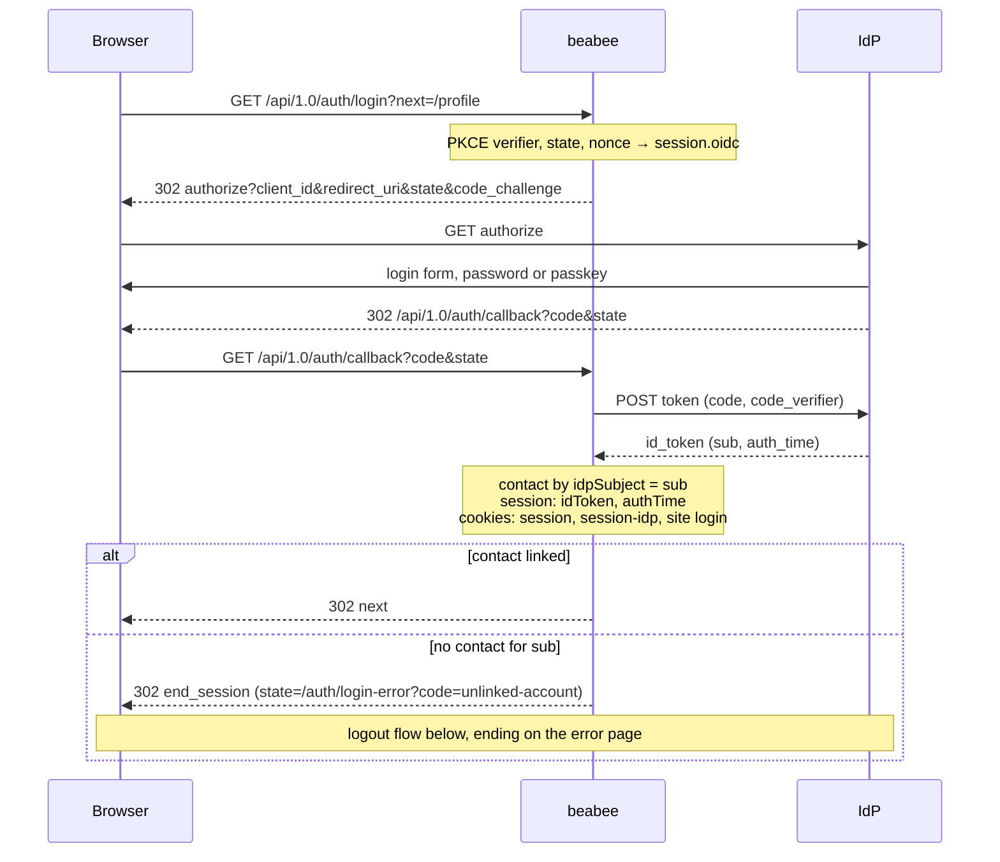
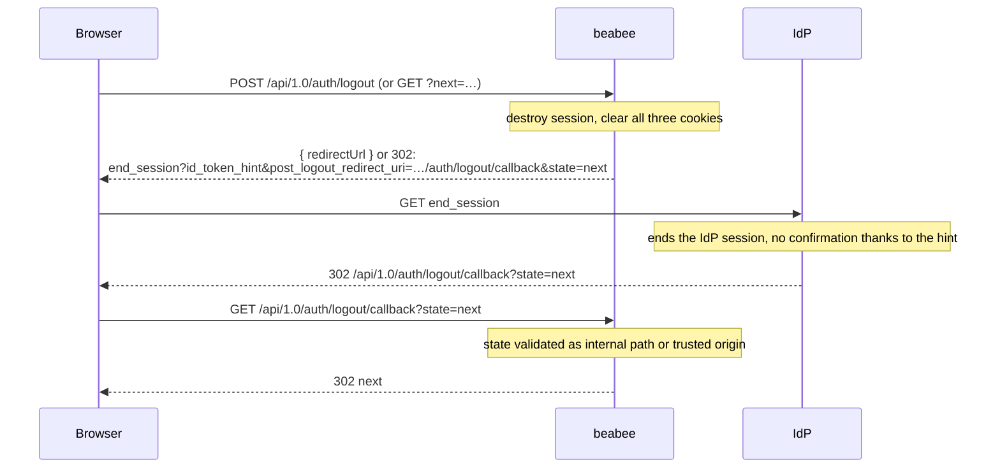
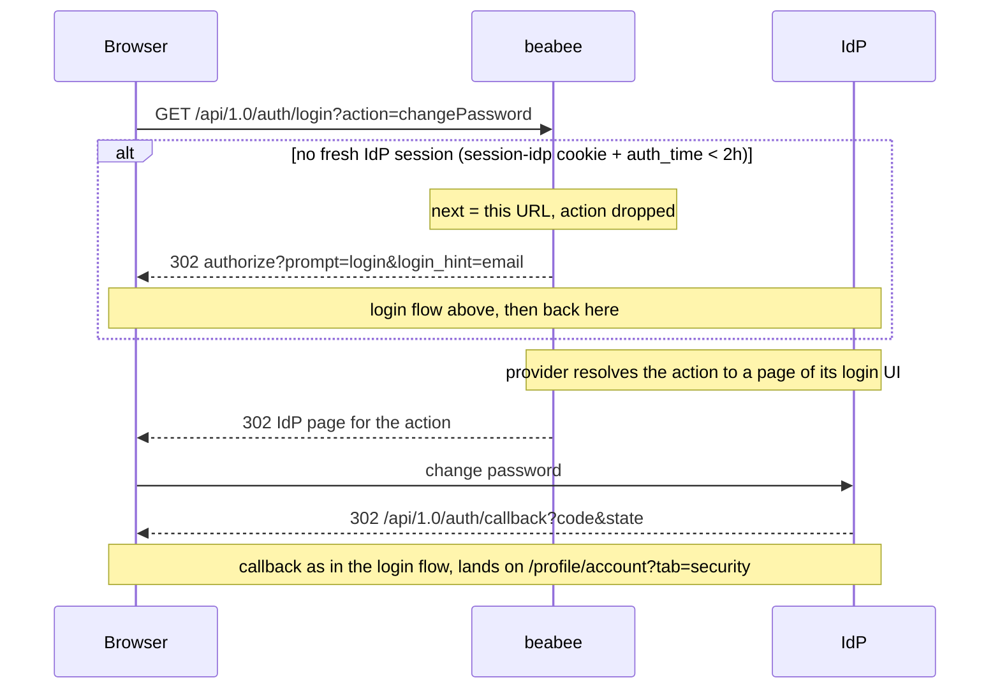
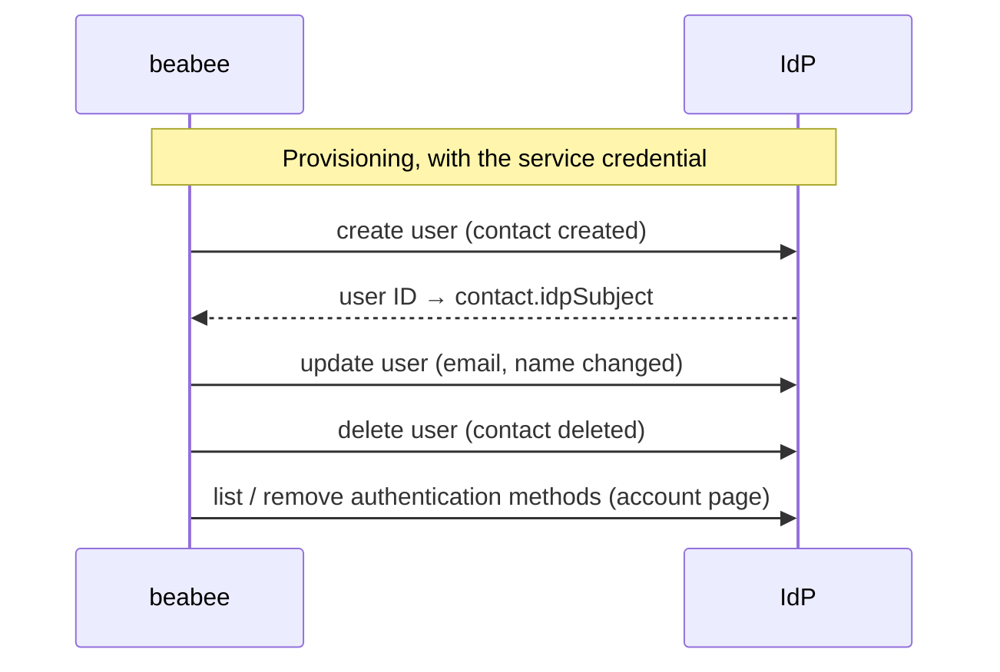
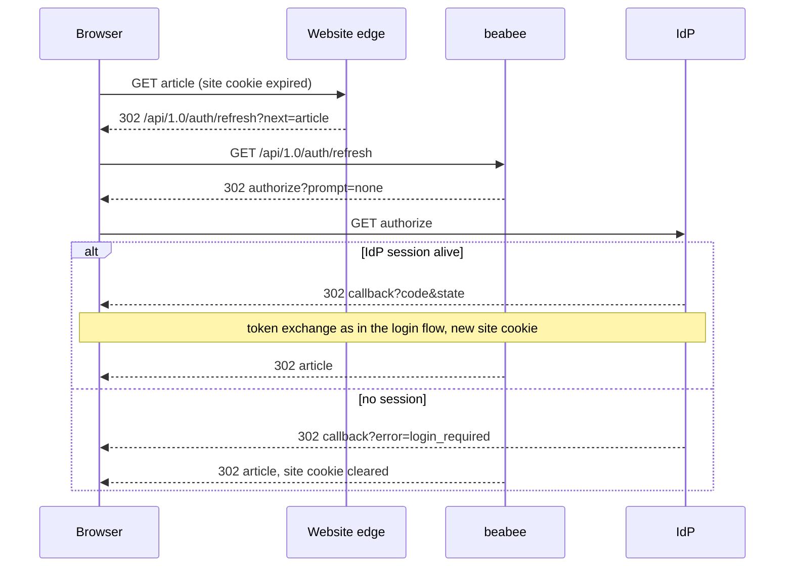

# OIDC login and identity provider integration

Design note for moving a beabee instance's authentication to an external
identity provider (IdP). Terms are defined in [`CONTEXT.md`](../../CONTEXT.md);
the decisions a reader is most likely to question are recorded in
[`docs/adr/`](../adr/). This page ties them together and is the reference for
the pull request stack that implements them.

This page covers what holds for any OIDC provider. How each provider fills
the provider-specific steps is in [Zitadel](./zitadel.md) (production) and
[Keycloak](./keycloak.md) (local development).

## Instance states

Two independent provider switches give three supported states. Any other
combination fails at boot.

| State          | `BEABEE_LOGIN_PROVIDER` | `BEABEE_IDP_PROVIDER`  | Members log in with |
| -------------- | ----------------------- | ---------------------- | ------------------- |
| Standalone     | `local`                 | `none`                 | beabee password     |
| IdP Transition | `local`                 | `zitadel` / `keycloak` | beabee password     |
| OIDC           | `oidc`                  | `zitadel` / `keycloak` | the IdP             |

Local Login and OIDC Login are never offered side by side. Moving from
Standalone to OIDC always passes through the IdP Transition.

## Principles

- **beabee is the system of record.** Contacts are created in beabee and
  mirrored to the IdP (IdP Provisioning); the IdP, payment and newsletter
  providers are all fed from the contact. Members have no way to edit their
  data at the IdP: its admin UI is hidden from them
  ([ADR-0005](../adr/0005-hide-the-idp-console-from-members.md)).
- **Linking is by IdP Subject only.** Login never matches by email and never
  creates a contact ([ADR-0001](../adr/0001-link-contacts-to-idp-by-subject-only.md)).
- **One IdP per beabee instance.** Each tenant has a dedicated IdP tenant
  (a Zitadel virtual instance, or a Keycloak realm in development); one
  service credential on that tenant is the only credential beabee holds.
- **IdP failures never block members.** Provisioning errors are logged at
  error level for the operators and reconciled with the CLI; admins are not
  shown them. Admin-facing pages show read-only link status only.
- **Zitadel is the production target.** Keycloak exists for local
  development; it gets the same features only where they are cheap.

## Flows

**Login (OIDC state).** `GET /auth/login` starts an authorization-code flow
with PKCE, state and nonce; the callback looks up the contact by IdP Subject
and establishes the normal session. Unlinked Contacts are logged out of the
IdP again and see an "unlinked account" error, so their next attempt starts
at the IdP's login form. Logout ends the IdP session as well (RP-initiated
logout): `POST /auth/logout` ends the beabee session and answers with the
IdP's logout URL for the client to navigate to, `GET /auth/logout` does the
same in one step for plain links. The IdP returns to
`GET /auth/logout/callback`, which continues to the `next` that travelled
through the IdP as the end-session `state`. Local-auth endpoints (password, MFA,
reset) return 404.

The token exchange is the only server-to-server step of a login; everything
else is a browser redirect.

**Joining (OIDC state).** The setup form has no password field. After the
confirm-email link, beabee finalises the Signup Flow, starts an OIDC login
that continues to the setup page, and hands the member to the IdP's
credential setup page inside that login (how each provider enters that
page is in its own document). The IdP completes the login and the member
arrives at the setup page through beabee's normal OIDC callback. Clicking
the confirmation link again after an abandoned setup starts a fresh login
and credential setup.

**Account management (OIDC state).** beabee's account page offers three
actions — change password, add a passkey, set up an authenticator app — each
an OIDC login that beabee starts with a Login Action
(`GET /auth/login?action=…`). The provider enters the matching page of its
own login UI inside that login. Adding a login method is as sensitive as
removing one, so an action needs a login at the IdP from the last two hours
(recent `auth_time`), like removal below. The pages also work on the IdP's
own login session, which the browser can lose while beabee's lives on (the
IdP keeps it in a cookie that ends with the browser); beabee mirrors that
cookie with one of its own, set by the OIDC callback without maxAge. An
action without both first goes through a fresh login (`prompt=login`,
returning to the action), which carries the member's email as `login_hint`
so the IdP skips its login name form. The pages ask for the current password
where needed and return to the account page through the OIDC callback
([ADR-0004](../adr/0004-link-to-login-v2-self-service-flows.md)). Removing a
passkey or authenticator app has no page at the IdP, so beabee's account
page does it through the provider's API instead: it shows which methods are
set up and removes one after a fresh login at the IdP (`prompt=login`,
recent `auth_time`), so that a hijacked session cannot strip a second
factor. Operators can still remove them in the IdP's admin UI
([ADR-0005](../adr/0005-hide-the-idp-console-from-members.md)).

**IdP Transition and cutover.** Existing password hashes cannot be imported
into the IdP ([ADR-0003](../adr/0003-migrate-passwords-by-capturing-at-login.md)).
Instead, at transition start operators provision all contacts and clear all
sessions; from then on every plaintext password beabee handles (login, join
setup, reset, change) is mirrored to the IdP and the contact's "credential
mirrored at" timestamp is set. Operators watch the unsynced count and cut
over by switching `BEABEE_LOGIN_PROVIDER` to `oidc`. Members who never
logged in during the transition use the IdP's password reset. Local hashes
are kept as the break-glass (revert the env var) and cleared later with the
CLI once no longer needed.

**Branding.** The IdP's login pages are styled from the beabee theme and
logo, pushed when the theme or logo is saved and by the CLI. What a
provider can take is in its own document.

**Server-to-server.** Provisioning and the account page's method removal
use the service credential; the login flows do not, apart from
provider-specific lookups.

## Configuration

Login: `BEABEE_LOGIN_PROVIDER=local|oidc` with `BEABEE_LOGIN_SETTINGS_`
`ISSUER`, `CLIENTID`, `CLIENTSECRET` (empty = public client), `SCOPES`. The
IdP client's redirect URI is `<audience>/api/1.0/auth/callback` and its
post-logout redirect URI `<audience>/api/1.0/auth/logout/callback`.

Provisioning: `BEABEE_IDP_PROVIDER=none|zitadel|keycloak` with the
`BEABEE_IDP_SETTINGS_*` values each provider's document lists.

Website login: `BEABEE_SITELOGIN_` `KEY` (32 bytes, base64, shared with the
website's edge; unset = off), `COOKIE_NAME`, `COOKIE_DOMAIN` (the parent domain;
`BEABEE_COOKIE_DOMAIN` stays the community host so the session cookie does not
spread), `COOKIE_MAXAGE` (seconds, longer than the ID token lifetime). Requires
`BEABEE_COOKIE_SECURE=true` for a `__Secure-` cookie name. The website links
to `/api/1.0/auth/login?next=<absolute URL>`; `next` may be any URL on a
`BEABEE_TRUSTEDORIGINS` origin. When the cookie's token has expired, the
website's edge sends the browser to `/api/1.0/auth/refresh?next=…`, one
`prompt=none` round trip that renews the cookie or, if the IdP session is
gone, clears it; either way the browser continues to `next`. A website logout
link is `/api/1.0/auth/logout?next=<absolute URL>`; the member returns to
that page via the logout callback, so the IdP needs only the one registered
post-logout redirect URI. The website's edge reads a `role` claim from the
token, which the IdP obtains from beabee's webhook app while issuing it: the
webhook answers with the contact's highest active role other than the admin
roles (`member` today), found by IdP subject, or no claim. A beabee outage
costs the role, not the login.

IdP-side setup that beabee owns is applied idempotently via
`backend-cli setup integrations idp`; what it covers is provider-specific.

## Operations

**Enabling OIDC Login** on an instance is the last step of the IdP
Transition: with provisioning already running and the unsynced count
acceptable, set `BEABEE_LOGIN_PROVIDER=oidc` plus the
`BEABEE_LOGIN_SETTINGS_*` values, clear all sessions and redeploy. The
backend refuses to start if `BEABEE_IDP_PROVIDER` is `none` at that point.
Clearing the sessions makes every member log in through the IdP, so each
session carries the ID token that logout uses as its hint.

**Break-glass.** If the IdP is unreachable or misconfigured nobody can log in,
operators included. The way back is to set `BEABEE_LOGIN_PROVIDER=local` and
redeploy: local password hashes are kept for exactly this reason, so members
who haven't changed their password at the IdP since can log in as before. The
OIDC discovery result is cached for the process lifetime; a restart picks up
changed IdP metadata.

## Pull request stack

Branches stack on each other in this order; each PR targets the previous
branch and is retargeted to `main` as its base merges.

1. `feat/idp-provider` — contact link column, provider abstraction and
   service, provisioning triggers, linking CLI, admin link status
2. `feat/idp-keycloak` — Keycloak provider and local development stack
3. `feat/idp-zitadel` — Zitadel provider
4. `feat/oidc-login-backend` — login provider config, OIDC routes, local-auth
   404s, client helpers
5. `feat/oidc-login-frontend` — login, logout and route guards in both
   frontends
6. `feat/oidc-account` — account page links to the IdP's self-service pages
7. `feat/oidc-signup` — join flow
8. `feat/oidc-self-service-removal` — authentication method status and
   removal on the account page, behind a fresh IdP login
9. `feat/idp-setup` — branding sync and `setup integrations idp`
10. `feat/idp-transition` — password mirroring, session clearing, unsynced
    count, hash clean-up

## Deliberately out of scope

Password hash import; a cutover mail-out; offering both login methods at
once; export for tenants leaving the hosting; font and background sync;
Keycloak branding; the legacy frontend; enforcing multi-factor
authentication.
