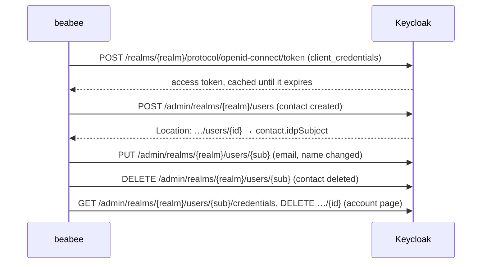

# Keycloak

How the provider-specific steps of [OIDC login](./README.md) are done at
Keycloak, the local development IdP. It gets the same features as Zitadel
only where they are cheap; branding is not synced. The docker-compose
stack, its setup and what the realm offers are in
[local identity provider development](../oidc-local-development.md).

## Tenant and credential

Each beabee instance is a Keycloak **realm**; beabee authenticates as a
service account client with the client credentials grant and uses the admin
REST API: `BEABEE_IDP_SETTINGS_` `URL`, `REALM`, `CLIENTID`, `CLIENTSECRET`.
Accounts use the email address as username.

## Login actions

Keycloak's application initiated actions: beabee appends `kc_action` to the
authorize URL and the browser follows it as a normal login, so no request ID
lookup is needed.

| Login Action     | `kc_action`                      |
| ---------------- | -------------------------------- |
| `changePassword` | `UPDATE_PASSWORD`                |
| `addPasskey`     | `webauthn-register-passwordless` |
| `setupMfa`       | `CONFIGURE_TOTP`                 |

**Joining** uses a magic link (the `keycloak-magic-link` extension in the
development image): beabee sets the `UPDATE_PASSWORD` required action on
the user and asks `POST /realms/{realm}/magic-link` for a link carrying the
parameters of its own authorization request (client, redirect URI, state,
nonce, PKCE challenge). Following the link logs the member in, makes them
set a password on the way and ends on beabee's callback with a code that
matches the login state.

**Removal** of a login method goes through `GET /users/{sub}/credentials`
and `DELETE /users/{sub}/credentials/{id}`; the method IDs are Keycloak's
credential IDs.

## Server-to-server

No role claim target: the website login is not exercised against Keycloak.
