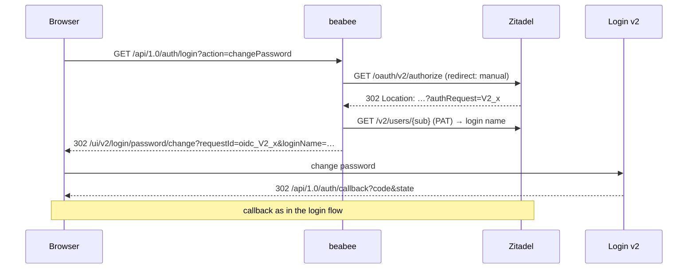
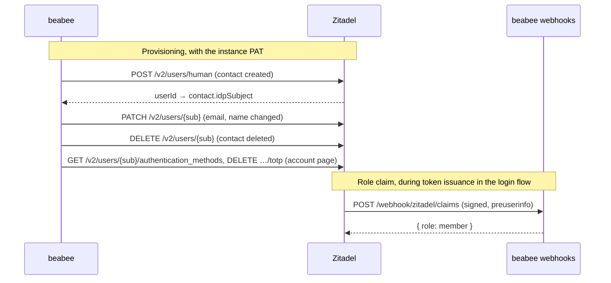

# Zitadel

How the provider-specific steps of [OIDC login](./README.md) are done at
Zitadel, the production IdP.

## Tenant and credential

Each beabee instance has a dedicated Zitadel **virtual instance**; one
service user with `IAM_OWNER` on that instance is the only credential beabee
holds, as a personal access token: `BEABEE_IDP_SETTINGS_` `URL`, `PAT`.

Zitadel is two things in the diagrams: **Zitadel** is the OIDC endpoints
(`/oauth/v2/authorize`, `/oauth/v2/token`, `/oidc/v1/end_session`) and the
management API; **Login v2** is the separate login UI under `/ui/v2/login`.
The browser talks to Login v2, beabee talks to Zitadel.

## Login actions

Every Login v2 page accepts the ID of an authorization request and completes
that request when the page is done. beabee requests the authorize endpoint
itself, without following the redirect, only to obtain that ID; the browser
then opens the Login v2 page directly with it and Login v2 completes the
login beabee started. Login v2's source supports this, its documentation
does not promise it ([ADR-0004](../adr/0004-link-to-login-v2-self-service-flows.md)).

| Login Action      | Login v2 page                           |
| ----------------- | --------------------------------------- |
| `changePassword`  | `/password/change`                      |
| `addPasskey`      | `/passkey/set`                          |
| `setupMfa`        | `/mfa/set`                              |
| `setupCredential` | `/verify` with an invite code (joining) |

**Joining** uses the same mechanism: beabee creates an invite code via
`POST /v2/users/{sub}/invite_code` and sends the browser to
`/ui/v2/login/verify?requestId&userId&code&invite=true`, where the member
chooses a password or passkey.

**Removal** of a passkey, security key or authenticator app goes through
`GET /v2/users/{sub}/authentication_methods` and the matching `DELETE`;
method IDs are `password`, `passkey-<id>`, `u2f-<id>` and `totp`.

## Server-to-server

The role claim for the website login is an Actions v2 target on the
`preuserinfo` function: `backend-cli setup integrations idp` registers the
webhook app's `/webhook/zitadel/claims` and stores its signing key in the
`zitadel-claims-signing-key` option. The target does not interrupt token
issuance.

## Setup owned by beabee

`backend-cli setup integrations idp` applies idempotently: `defaultRedirectUri`
(beabee's login endpoint, the safety net for a member who finishes a Login v2
page outside a login beabee started), `ignoreUnknownUsernames`, the lockout
policy (10 password and 5 OTP attempts; Zitadel then locks the account until
`backend-cli user unlock` lifts it), the email provider (beabee's own email
account from `BEABEE_EMAIL_*` and the support email options, so the IdP's
password reset and OTP mails leave like beabee's; Mandrill and SendGrid via
their SMTP relays), the login page wording (the login name field is labelled
as the email address, in every language beabee's locales translate it),
branding and, on an OIDC Login instance whose issuer is this IdP, the OIDC
client's redirect and post-logout URI lists. The virtual instance, project
and OIDC client are created by the hosting infrastructure, which is expected
to call the same command in future.

**Branding.** The instance's label policy is set from the beabee theme: the
main, body, danger and white colours map to Zitadel's primary, font, warn and
background colours (light and dark alike, theme mode forced light) plus the
logo as logo and icon. Fonts and the splash background image are not synced
(Zitadel has one font file per instance and no per-instance background
before v5).

## Refresh tokens

The website login is renewed with refresh tokens rather than a `prompt=none`
round trip: Login v2 answers `prompt=none` without a session with its login
form or a JSON 400 instead of `error=login_required`
([zitadel#12165](https://github.com/zitadel/zitadel/issues/12165)), which
would strand a reader there. The OIDC client needs the refresh token grant
type. Zitadel issues one to the public PKCE client on `offline_access` and
rotates it on every use, after which the previous token is rejected with
`RefreshTokenInvalid`; the refreshed ID token keeps the login's `auth_time`.
Ending the IdP session (`/oidc/v1/end_session`) leaves the refresh token
valid, so beabee revokes it at `/oauth/v2/revoke` on logout.

## Operations

**Upgrading Login v2.** After an upgrade, check that entering a page with a
request ID still holds: request the instance's OIDC authorize URL with the
tenant's client and read the `authRequest` ID from the redirect, open
`/ui/v2/login/password/change?requestId=oidc_<id>&loginName=<login name>`
in a browser logged in at the IdP, change the password, and confirm the
browser lands on beabee's `/api/1.0/auth/callback` with `code` and the
original `state`. If it doesn't, members finishing a page land on the
`defaultRedirectUri` instead of where they started.

**Hiding the Console.** The hosting infrastructure blocks `/ui/console` on
the tenant's login domain and redirects it to the tenant's beabee URL;
operators use the Console on the instance's generated domain instead, which
is also where they remove a member's passkey or authenticator app on request.
The IdP's password-change notification is switched off in its notification
policy, as the mail would link to the Console.

A hosted dev instance for local stacks is described in
[local identity provider development](../oidc-local-development.md).
